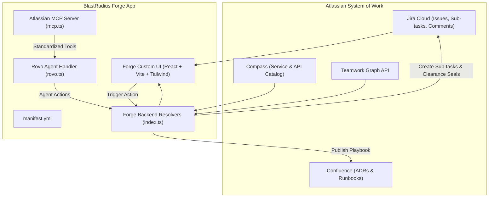

# 💥 BlastRadius: Architectural Impact & Dependency Radar

> **Codegeist 2026 Submission**  
> *Category:* **Apps for Software Teams** ($15,000)  
> *Bonus Tracks:* **Best Atlassian MCP App**, **Best Agents (Rovo)** & **Best Teamwork Graph Integration**

- 🚀 **Live Interactive Demo (Vercel):** [https://frontend-sandy-mu-63.vercel.app](https://frontend-sandy-mu-63.vercel.app)
- 🏢 **Atlassian Cloud Site (Jira):** [https://monudevdil0301.atlassian.net](https://monudevdil0301.atlassian.net)
- 📦 **GitHub Repository:** [https://github.com/monudevdil0301-ux/blast-radius](https://github.com/monudevdil0301-ux/blast-radius)

BlastRadius is an AI-powered architectural impact sentry built natively on **Atlassian Forge**. It automatically analyzes microservice dependencies across the **Teamwork Graph** and **Compass**, computes real-time blast radius risk scores on Jira tickets, simulates cascading shockwaves, scans Git code diffs for breaking API signatures, provides Change Advisory Board (CAB) pre-flight clearance seals, and uses an autonomous **Rovo Agent** & **Atlassian MCP Server** to generate regression suites and Confluence rollback runbooks.

---

## 🌟 Core Superpowers

1. **🕸️ Particle Topology Canvas with Shockwave Cascade:**
   - Real-time 3-tier microservice dependency graph (Target, Direct Callers, Perimeter Storage/Gateways).
   - Live data packet animations flowing across nodes.
   - Interactive zoom/pan controls and a *"Simulate Cascade Shockwave"* button that ripples failure animations across dependent tiers in real time.

2. **🔌 Atlassian Model Context Protocol (MCP) Server:**
   - Exposes standardized MCP tool schemas for external AI agents (Claude Desktop, Cursor, and Atlassian Rovo):
     - `blastradius_inspect_dependencies`
     - `blastradius_simulate_failure`
     - `blastradius_scan_code_diff`
     - `blastradius_verify_preflight_clearance`

3. **🔍 Git Code Diff & Breaking Contract Scanner:**
   - Evaluates unified git diffs against downstream Compass component APIs.
   - Detects breaking parameter alterations and schema key changes before build pipelines.
   - Flags exact downstream consumer code lines (e.g. `billing-api/auth_middleware.go:42`).

4. **🛡️ CAB Pre-Flight Deployment Clearance Gate:**
   - Evaluates 5 automated architectural criteria (Compass Tier 1 Health >= 80%, Zero unmitigated P1s, Runbook freshness, Regression coverage, Owner sign-off).
   - Generates a certified cryptographic clearance seal and stamps it directly as an official Jira issue comment.

5. **🤖 Autonomous Rovo Sentry (`@BlastRadius`):**
   - Natural language AI agent registered via `rovo:agent` and `action:` tools that audits architecture and executes tool calls.

6. **📄 1-Click Executive Risk Briefing Exporter:**
   - Exports audit-grade Markdown and Confluence-ready briefings for Change Advisory Board and executive leadership reviews.

---

## 🏗️ Architecture Diagram



---

## 🚀 Quickstart & Development

### 1. Standalone Frontend Preview
Test and explore all tabs locally without needing an Atlassian account:

```bash
cd static/frontend
npm install
npm run dev
```
Open [http://localhost:3000](http://localhost:3000) in your browser.

### 2. Atlassian Cloud Deployment
```bash
# 1. Build frontend and backend
npm run build:all

# 2. Deploy to Atlassian Cloud
forge deploy -e production

# 3. Install onto Jira Cloud
forge install -e production --site your-domain.atlassian.net --product jira
```
