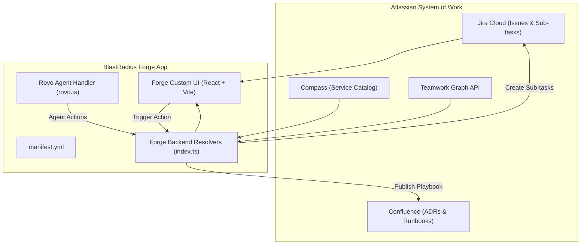

# 💥 BlastRadius: Architectural Impact & Dependency Radar

> **Codegeist 2026 Submission**  
> *Category:* **Apps for Software Teams**  
> *Bonus Tracks:* **Best Agents (Rovo)** & **Best Teamwork Graph Integration**

BlastRadius is an AI-powered architectural impact sentry built natively on **Atlassian Forge**. It automatically analyzes microservice dependencies across the **Teamwork Graph** and **Compass**, computes real-time blast radius risk scores on Jira tickets, simulates cascading failures, and uses an autonomous **Rovo Agent** to generate regression test suites and Confluence rollback runbooks.

---

## 📸 Key Features

- **🕸️ Interactive Blast Radius Canvas:** Live 3-tier dependency graph embedded directly inside the Jira issue panel, showing root targets, direct consumers, and perimeter databases/gateways.
- **📊 Bayesian Risk Gauge (0-100):** Weighted risk index factoring downstream consumer criticality, P1 incident histories in the last 90 days, and stale Confluence runbooks.
- **⚡ Chaos & Cascading Failure Simulator:** Synthetic failure injection (latency spikes, unhandled 401s, connection pool exhaustion) with circuit breaker predictions.
- **🤖 Autonomous Rovo Sentry (`@BlastRadius`):** Natural language AI agent registered via `rovo:agent` and `rovo:action` that audits architecture and executes tool calls.
- **🛠️ 1-Click Governance:**
  - Auto-generate linked Jira regression sub-tasks for affected downstream services.
  - Publish an emergency rollback playbook directly to Confluence.
  - Broadcast impact notices to component owner teams.

---

## 🏗️ Architecture Diagram



---

## 🚀 Quickstart & Development

### 1. Prerequisites
- Node.js (v18+)
- Atlassian Forge CLI (`npm install -g @forge/cli`)

### 2. Standalone Frontend Preview (No Forge Account Needed)
You can test and demo the entire interactive UI locally:

```bash
cd static/frontend
npm install
npm run dev
```
Open [http://localhost:3000](http://localhost:3000) in your browser. You can toggle between demo Jira issues (`AUTH-412` Critical, `PAY-892` Elevated), simulate failures, run Rovo chat, and trigger sub-task generation!

### 3. Deploying to Atlassian Cloud via Forge
When ready to install into your Atlassian Cloud developer site:

```bash
# 1. Build the Custom UI bundle
cd static/frontend
npm run build
cd ../..

# 2. Login to Atlassian Forge
forge login

# 3. Register your app ID
forge register

# 4. Deploy and install
forge deploy
forge install
```

---

## 📂 Project Structure

```
blastradius/
├── manifest.yml                # Forge App & Rovo Agent manifest
├── package.json                # Root Forge dependencies
├── tsconfig.json               # Backend TypeScript configuration
├── src/
│   ├── index.ts                # Forge Resolvers (Jira & Confluence APIs)
│   ├── rovo.ts                 # Rovo Agent Action Handlers
│   └── types.ts                # Shared TypeScript definitions
├── static/
│   └── frontend/               # Custom UI (React + Vite + Tailwind)
│       ├── src/
│       │   ├── components/     # Canvas, RiskGauge, Simulator, ActionConsole
│       │   ├── bridge.ts       # Forge Bridge & Mock Fallback Layer
│       │   ├── App.tsx         # Main Dashboard
│       │   └── main.tsx
│       ├── package.json
│       └── vite.config.ts
├── DEVPOST.md                  # Complete Devpost Submission Pitch
└── DEMO_SCRIPT.md              # 3-5 Minute Video Recording Script
```
